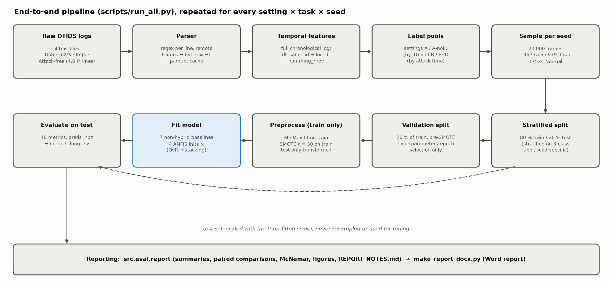
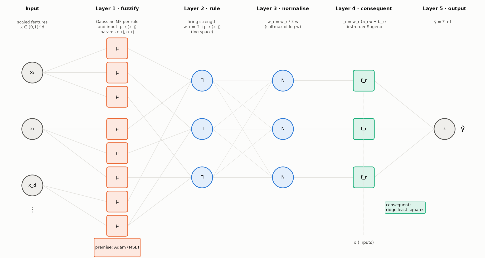
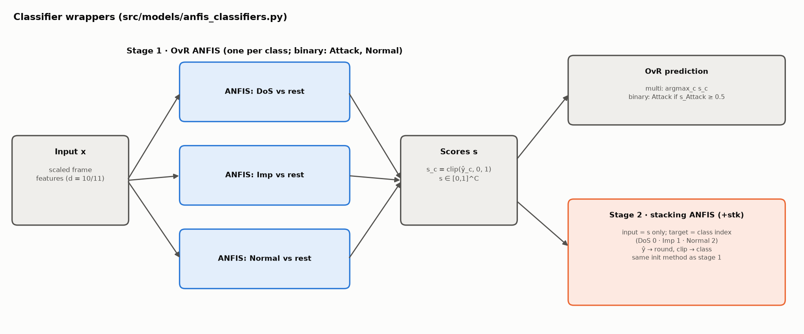

# System architecture and implementation details

This document describes how every part of the study is built: the data pipeline, the shared
experimental protocol and each method tested. All hyperparameters live in `configs/default.yaml`; the
values quoted here are the ones used for every reported result.

## 1. Overview

The system is a single Python package (`src/`) driven by a few scripts (`scripts/`). One run, for one
setting, task and seed, goes through the same pipeline for every model, so the only thing that differs
between two result rows is the model itself.



| layer | module | responsibility |
|---|---|---|
| data | `src/data/parse_otids.py` | parse the four OTIDS text logs, cache as parquet |
| data | `src/data/features.py` | per-frame temporal features on the full chronological log |
| data | `src/data/build_dataset.py` | label pools per setting, 20k sampling, splits, scaling, SMOTE |
| models | `src/models/anfis.py` | ANFIS network and hybrid learning (PyTorch) |
| models | `src/models/subclust.py`, `inits.py` | the four initial-FIS generators |
| models | `src/models/anfis_classifiers.py` | OvR ANFIS and the stacked (augmented) ANFIS |
| models | `src/models/fcm_classifier.py`, `baselines.py` | non-hybrid baselines |
| evaluation | `src/eval/metrics.py`, `stats.py` | per-run metrics, McNemar test |
| evaluation | `src/eval/report.py`, `notes.py`, `plots.py` | aggregation, paired comparisons, figures, notes |
| drivers | `scripts/run_all.py` | the experiment loop (settings × tasks × seeds × models) |
| drivers | `scripts/data_report.py`, `probe_B.py`, `rule_sweep.py` | data analysis, Setting B probe, R sweep |
| drivers | `scripts/make_report_docx.py`, `make_arch_figures.py` | Word report and these diagrams |

**Environment.** Python 3.11 (conda env `can-anfis`, pinned in `environment.yml`): PyTorch 2.6 (CUDA
12.4), scikit-learn, imbalanced-learn, scikit-fuzzy, numpy/pandas/pyarrow, matplotlib. ANFIS runs on the
GPU (RTX 4060) when available; everything else runs on the CPU. Native thread pools are capped (OpenMP,
OpenBLAS and MKL at 8 threads, torch at 4, Random Forest `n_jobs = 8`) because uncapped pools
oversubscribed the 20-core CPU and stalled runs.

## 2. Data pipeline

### 2.1 Parsing

Each OTIDS line has the form `Timestamp: 0.000224  ID: 0329  000  DLC: 8  d7 a7 7f 8c 11 2f 00 10`.
A single regular expression extracts timestamp, CAN ID (hex), flag, DLC and the data bytes.

- **Remote frames** (flag `100`, DLC 0) carry no data; their bytes are stored as −1.
- **Short frames** (DLC < 8): missing bytes are −1. Trailing ASCII columns (two Fuzzy-log lines) are ignored.
- **Timestamps:** the Impersonation log uses absolute UNIX time, the others start at 0, so every log gets
  `t_rel = timestamp − first timestamp`.
- All 4.6 M lines parse (0 rejected). Each log is cached to `data/processed/<log>.parquet`.

### 2.2 Temporal features

Computed on the **full chronological log, before any sampling**, so a sampled frame still sees its true
predecessor:

- `dt_same_id`: seconds since the previous frame with the same CAN ID. The first frame of each ID gets
  that ID's median gap. Used as `log_dt = log10(max(dt, 1e-6))`, because dt is heavy-tailed and min-max
  scaling would otherwise squash almost all frames into a tiny range.
- `hamming_prev`: number of payload bits that changed versus the previous frame of the same ID (used by
  the Setting B probe only).

### 2.3 Label pools and settings

Labels are 0 = DoS, 1 = Impersonation, 2 = Normal. The binary task maps DoS and Imp to Attack (0) and
Normal to 1.

| setting | DoS pool | Imp pool | Normal pool | inputs |
|---|---|---|---|---|
| A | 0x000 frames, DoS log | all 0x164 frames, imp. log | attack-free log, IDs other than 0x000/0x164 | can_id, dlc, d0–d7 |
| A-noID | as A | as A | as A | dlc, d0–d7, log_dt |
| B | as A | 0x164 frames with t_rel ≥ 250 s, imp. log | every other imp.-log frame (incl. genuine 0x164 before 250 s) | dlc, d0–d7, log_dt |
| B-ID | as B | as B | as B | can_id, dlc, d0–d7, log_dt |

### 2.4 Sampling, splitting and preprocessing

1. **Sample:** per seed, draw without replacement exactly 1,497 DoS, 979 Imp and 17,524 Normal frames
   (the paper's 20,000-row class totals).
2. **Split:** stratified 80/20 train/test (16,000 / 4,000), stratified on the 3-class label so the binary
   and multiclass tasks use the same rows for a given seed.
3. **Validation split** (tuning only): 20 % of the training rows, carved **before** SMOTE. It is used to
   choose baseline hyperparameters and, in the 5-epoch ablation, ANFIS epoch counts. Models are then
   refit on the full training set.
4. **Scaling:** `MinMaxScaler` fitted on the training rows only; validation and test are only transformed.
5. **SMOTE** (`k_neighbors = 30`, `sampling_strategy = "not majority"`) on the scaled training rows only.
   It brings every minority class up to the majority count: multiclass training grows from 16,000 to
   42,057 rows (3 × 14,019), binary to 28,038 (2 × 14,019). If a class had ≤ 30 rows, k would be reduced
   automatically.

The test set is never resampled and never used for any decision.

## 3. ANFIS (hybrid neuro-fuzzy)

### 3.1 Network

A first-order Takagi–Sugeno ANFIS, written from scratch in PyTorch (`src/models/anfis.py`). With d inputs
and R rules:



| layer | operation | parameters |
|---|---|---|
| 1 · fuzzification | Gaussian MF per rule and input: μ_rj(x_j) = exp(−(x_j − c_rj)² / 2σ_rj²) | centres c (R × d), widths σ (R × d) |
| 2 · rule firing | product t-norm: w_r = Π_j μ_rj(x_j), computed as log w_r = −½ Σ_j ((x_j − c_rj)/σ_rj)² | – |
| 3 · normalisation | w̄_r = w_r / Σ_k w_k, implemented as softmax(log w) | – |
| 4 · consequents | f_r = w̄_r · (a_r · x + b_r) | a (R × d), b (R) |
| 5 · output | ŷ = Σ_r f_r | – |

Implementation choices:

- **Log-space firing.** With 10–11 inputs, the product of Gaussians underflows to 0 far from every
  centre. Computing log w and normalising with softmax is numerically identical in exact arithmetic but
  never divides 0 by 0.
- **Widths** are stored as log σ (keeps them positive under gradient steps) and clamped at σ ≥ 1e-3.
- **Parameter count** per ANFIS: 2Rd premise + R(d + 1) consequent. For R = 10, d = 10: 200 + 110 = 310.

### 3.2 Hybrid learning

Jang's hybrid rule, one epoch at a time:

1. **Forward pass, least squares.** With the premise fixed, the output is linear in the consequents:
   ŷ = Φθ, where each row of Φ is [w̄_1·x, w̄_1, …, w̄_R·x, w̄_R] (R(d + 1) columns). θ is solved by ridge
   regression from the normal equations (ΦᵀΦ + λI)θ = Φᵀy, with λ = 1e-6. ΦᵀΦ is accumulated in chunks
   of 8,192 rows in float64 and solved with `torch.linalg.solve`.
2. **Backward pass, gradient descent.** With θ fixed, one pass of Adam (lr 0.01, mini-batch 512, shuffled)
   on the MSE updates centres and log-widths.
3. After the last epoch, θ is re-solved once so the consequents match the final premise.

| hyperparameter | value | source |
|---|---|---|
| epochs | 1 (5 in the ablation) | paper |
| optimiser (premise) | Adam, lr 0.01, batch 512 | ours (MATLAB's `anfis` uses gradient descent with an adaptive step) |
| ridge λ | 1e-6 | ours (numerical stability only) |
| σ floor | 1e-3 (network), 1e-2 (initial widths) | ours |
| loss | MSE against the 0/1 target (OvR) or the class index (stage 2) | standard ANFIS |

**5-epoch ablation.** For each OvR member, training runs up to 5 epochs on the validation-split data with
early stopping on validation MSE (patience 2). The epoch with the lowest validation MSE is kept, and the
member is refit on the full training set for that many epochs.

### 3.3 Initial FIS: the four initialisation methods

All four produce initial centres (R × d) and widths (R × d) through one interface
(`src/models/inits.py`). Like MATLAB's `genfis2`/`genfis3`, the three clustering methods cluster the joint
space [x, target] and then drop the target coordinate, so clusters respect class structure. The Random
control uses x only.

| init | centres | widths | rules per member | role |
|---|---|---|---|---|
| Random | R training points drawn uniformly at random | global per-feature std of the training data | 10 (fixed) | control: no clustering |
| K-Means | K-Means centroids (`n_init` 10) | per-cluster per-feature std (global std if < 2 points) | 10 (fixed) | hard clustering |
| SC | subtractive-clustering centres | r_a × span / √8 per feature, same for all rules | data-driven (3–25 observed) | paper's method 1 |
| FCM | fuzzy c-means centres (m = 2) | √(Σ u^m (x − c)² / Σ u^m) per cluster and feature | 10 (fixed) | paper's method 2, fuzzy clustering |

All widths are floored at 1e-2 so no MF starts as a spike.


**Subtractive clustering** (`src/models/subclust.py`) follows Chiu (1994) and MATLAB's `subclust`:

1. Normalise data to the unit hypercube using the training-set bounds.
2. Potential of each point: P_i = Σ_j exp(−4‖z_i − z_j‖² / r_a²).
3. Repeatedly take the highest-potential point as a candidate centre. Accept it if P ≥ 0.5 × P_first;
   reject and stop if P ≤ 0.15 × P_first; in between (grey zone) accept only if
   d_min / r_a + P / P_first ≥ 1, where d_min is the distance to the nearest existing centre.
4. After accepting a centre, subtract its influence: P_i ← P_i − P_k · exp(−4‖z_i − z_k‖² / r_b²) with
   r_b = squash × r_a.

Settings: radius r_a = 0.20 (binary) / 0.25 (multiclass) and squash factor 0.20 / 0.25, as in the paper.
MATLAB's default squash of 1.25 collapsed to 2 rules per member and lost accuracy, so the paper's values
were kept. SC needs the full N × N distance matrix, so it runs on a class-stratified subsample of at most
5,000 training points, with bounds taken from the full training set.

**FCM** uses `skfuzzy.cluster.cmeans` with c = 10, m = 2, at most 100 iterations, tolerance 1e-5. It is
the slowest init (4–6× K-Means) because it iterates over the full SMOTE'd training set (28–42 k rows).

### 3.4 Classifier wrappers: OvR and stacking



**OvR ANFIS** (rows named `ANFIS-<init>`). One ANFIS per class (3 for multiclass; 2 for binary, Attack
and Normal), each regressing the 0/1 indicator of its class with MSE. Outputs are clipped to [0, 1] and
used as class scores. Multiclass prediction is the argmax; binary prediction is Attack if the Attack score
is ≥ 0.5. Each member gets its own initial FIS, built from the joint space of x and its own 0/1 target.

**Stacked ANFIS** (rows named `ANFIS-<init>+stk`), the paper's "augmented ANFIS":

- Stage 1 is the OvR ANFIS above.
- Stage 2 is one more ANFIS whose **input is the stage-1 score vector s only** (2 or 3 values, not the
  original features) and whose target is the integer class index (DoS 0, Imp 1, Normal 2; binary Attack 0,
  Normal 1). Its prediction is rounded and clipped to a valid index. This is our reading of the paper's
  description. One consequence: Imp (index 1) sits between DoS and Normal, so stage-2 regression errors
  tend to land on Imp.
- Stage 2 uses the same init method and hyperparameters as stage 1 (10 rules, 20 in the `R20` ablation, or SC's own count).
- **Stacking mode.** `paper` (default) trains stage 2 on stage 1's in-sample scores on the training set.
  `oof` (ablation) trains it on 5-fold out-of-fold scores instead.
- Both rows come from **one** fit: the OvR row reports stage 1 alone (its training time excludes
  stage 2); the `+stk` row reports the full model.

Rule counts: R/K-Means/FCM have 20 (binary) or 30 (multi) rules in stage 1 and 10 more in stage 2. SC
totals 43 / 50 rules in stage 1 and 50 / 63 with stacking (A-noID means).

## 4. Non-hybrid baselines

All baselines use the same scaled, SMOTE'd training data. Hyperparameters marked as a grid are chosen by
macro-F1 on the validation split, then the model is refit on the full training set.

| model | family | implementation | fixed settings | tuned on validation |
|---|---|---|---|---|
| MLP | pure neural | `sklearn MLPClassifier` | ReLU, Adam lr 1e-3, ≤ 50 epochs, early stopping (10 % internal hold-out, patience 5) | hidden layers ∈ {(32), (64), (64, 32)} |
| FCM classifier | pure fuzzy | own (`fcm_classifier.py`) | m = 2, skfuzzy c-means | clusters k ∈ {10, 20, 30} |
| LDA | classical | `LinearDiscriminantAnalysis` | defaults (SVD solver) | – |
| LR | classical | `LogisticRegression` | lbfgs, max_iter 2000 | C ∈ {0.1, 1, 10} |
| Linear SVM | classical | `LinearSVC` | max_iter 5000 | C ∈ {0.1, 1, 10} |
| RBF SVM | classical | `SVC(kernel="rbf")` | gamma = "scale" | C ∈ {1, 10} |
| Random Forest | classical ensemble | `RandomForestClassifier` | 200 trees | max_depth ∈ {None, 20} |

**FCM classifier** is the "fuzzy without learning" ingredient of ANFIS:

1. Fuzzy c-means on the training inputs gives k centres and a membership matrix U (k × N).
2. Each cluster gets a class distribution: the membership-weighted class frequencies,
   D = normalise_rows(U · onehot(y)).
3. A new frame gets memberships u (from `cmeans_predict` against the fixed centres), class scores u · D,
   and the argmax class.

It has rules (clusters) but no consequent fitting and no tuning of membership functions. Comparing it with
ANFIS-FCM therefore isolates what ANFIS's neural learning adds.

The MLP is the "neural without fuzzy rules" ingredient; comparing it with ANFIS isolates what the fuzzy
rule structure adds.

## 5. Evaluation

### 5.1 Per-run metrics

For each run, predictions on the 4,000 test frames give (`src/eval/metrics.py`):

- accuracy; macro precision, recall and F1 (unweighted mean over classes; **macro-F1 is the primary
  metric** because 88 % of frames are Normal);
- per class: precision, recall, F1 and one-vs-rest TPR, TNR, FPR, FNR, plus their macro averages;
- `train_time_s` (wall clock, fit only), `infer_ms_per_1k`, `n_rules`, and the chosen hyperparameters.

Everything goes to `results/metrics_long.csv` (one row per metric), predictions to
`results/preds/*.npz`, and the seed-0 ANFIS membership functions (initial and trained) to
`results/anfis_params/*.npz`.

### 5.2 Comparisons and significance

- Each table shows mean ± std over the 5 seeds.
- **Paired differences.** Two models are compared on the same seed (same sample, split and SMOTE), giving
  5 paired differences. A difference is called "within noise" when |mean Δ| ≤ std(Δ) or
  |mean Δ| < 0.0025 (about one Imp test error); otherwise better or worse. The number of seeds won is
  reported alongside.
- **McNemar test** (exact binomial) on seed 0: counts the test frames only model A gets right versus only
  model B gets right.
- The headline hybrid for comparison 1 is fixed in advance (`ANFIS-FCM+stk`); the best ANFIS by test score
  is also shown but flagged as post hoc.

### 5.3 Auxiliary experiments

| experiment | script | method |
|---|---|---|
| data report | `scripts/data_report.py` | 0x164 traffic before vs after 250 s: rates, χ² on payload patterns, KS on dt (with an attack-free control), rolling counter, per-ID rates |
| Setting B probe | `scripts/probe_B.py` | classify 0x164 frames as before/after 250 s with LR, RF and ANFIS-FCM; feature groups payload / timing / all; StratifiedGroupKFold (5 folds, 10 s time blocks as groups), ROC AUC per fold; control = same probe on attack-free data with a fake boundary |
| rule sweep | `scripts/rule_sweep.py` | ANFIS-KMeans with R ∈ {5, 10, 20} per member, scored on the validation split only |
| ablations | `run_all.py --tag …` | `ep5` (5 epochs), `oof` (out-of-fold stacking), `nosmote`, `R20` (20 rules) |

## 6. Testing

`tests/` (pytest, 13 tests, ≈ 15 s):

- **parser:** full line, short DLC, remote frame, trailing ASCII column, absolute timestamps;
- **preprocessing:** SMOTE touches training data only, the scaler is fitted on training data only, SMOTE
  k is reduced for tiny classes;
- **subtractive clustering:** finds the three centres of three synthetic blobs;
- **ANFIS:** fits sin(x)·cos(y) to RMSE < 0.05, learns XOR, and the least-squares step matches
  `numpy.linalg.lstsq`;
- **inits:** K-Means centres lie in the data range and respect the width floor; FCM and SC return
  correctly shaped outputs.

## 7. Reproducing

```
conda env create -f environment.yml && conda activate can-anfis
python -m pytest -q tests
python scripts/run_all.py --setting A A-noID B B-ID --task binary multi --seeds 5
python scripts/run_all.py --setting A A-noID B --task binary multi --models ANFIS-Random ANFIS-KMeans ANFIS-SC ANFIS-FCM --epochs 5 --tag ep5
python scripts/run_all.py --setting A A-noID --task binary multi --models ANFIS-SC ANFIS-FCM ANFIS-KMeans --stack-mode oof --tag oof
python scripts/run_all.py --setting A-noID --task binary multi --no-smote --tag nosmote
python scripts/run_all.py --setting A-noID --task binary multi --models ANFIS-Random ANFIS-KMeans ANFIS-FCM --n-rules 20 --tag R20
python scripts/rule_sweep.py && python scripts/probe_B.py
python -m src.eval.report && python scripts/make_arch_figures.py && python scripts/make_report_docx.py
```

Runtime on a 20-core CPU + RTX 4060: about 40 min for the main grid and 30 min for all ablations.
